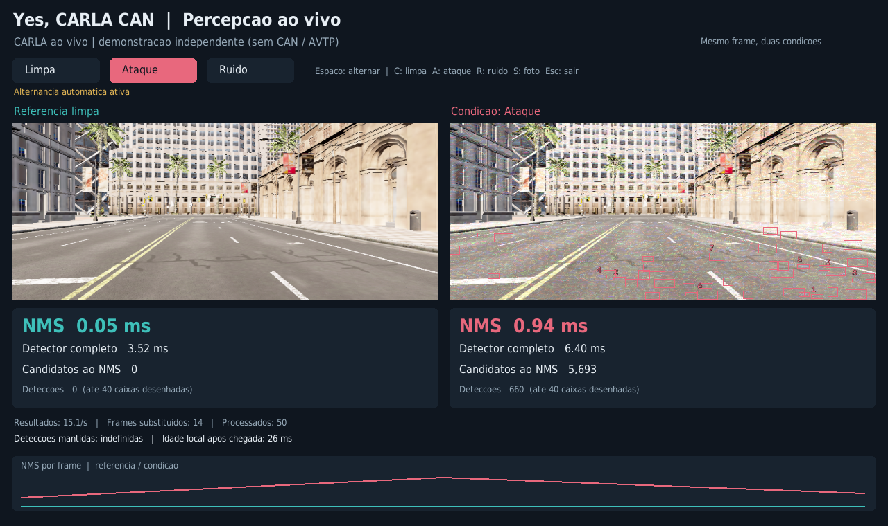

# Demonstração visual ao vivo

O painel compara duas condições do **mesmo frame**: referência limpa à esquerda e condição escolhida à direita. Ele apresenta as caixas detectadas, os candidatos ao NMS, o tempo do NMS, o tempo do detector e a proporção de detecções limpas mantidas.



## Um comando para experimentar

Na raiz do repositório:

```bash
./scripts/live_perception_demo.sh
```

O launcher reutiliza um servidor CARLA já disponível. Se o servidor não estiver em execução, inicia a instalação local em `carla-0-9-15`. Quando encontra o veículo `hero` do Yes Carla Can, anexa uma câmera de observação. Se não houver esse veículo, cria uma demonstração independente com um veículo em piloto automático e até oito veículos adicionais. O próprio painel identifica esse caso como demonstração sem CAN/AVTP.

Ao fechar, o módulo remove a câmera e os atores que criou. Um servidor iniciado pelo launcher é encerrado junto com a demonstração. Servidores e veículos preexistentes não são encerrados nem têm seu controle alterado.

## Controles

| Ação | Controle |
| --- | --- |
| Alternar limpa/ataque | **Espaço** |
| Usar imagem limpa | **C** ou botão **Limpa** |
| Ativar perturbação | **A** ou botão **Ataque** |
| Comparar ruído comum | **R** ou botão **Ruído** |
| Salvar a tela do painel | **S** |
| Fechar o painel | **Esc**, **Q** ou fechar a janela |

O delta padrão é `.perception/runs/bdd-r04/delta.npy`, treinado no primeiro piloto. Outro delta pode ser selecionado com `--delta /caminho/delta.npy`. Pesos e ambiente seguem o [guia da percepção](perception-latency.md).

## Acompanhar o veículo do Yes Carla Can

Com o ambiente e o cliente habituais já em execução:

```bash
./scripts/run_perception.sh live --source carla --snapshots
```

Esse modo exige um veículo com `role_name=hero`. Use `--actor-id NUMERO` ou `--rolename NOME` para acompanhar outro veículo. Ele cria uma câmera com posição e resolução equivalentes às da câmera RGB do projeto, usando a conexão do CARLA. Essa entrada **não passa pelo transporte AVTP**. O painel não injeta comandos CAN nem modifica o controlador do veículo.

Se o cliente recriar o veículo, reabra o painel para anexá-lo ao novo ator. O painel observa os ticks existentes; não altera o modo síncrono do mundo nem avança o simulador por conta própria.

## Consumir o vídeo AVTP

O mesmo painel também aceita os pacotes de vídeo enviados pela câmera existente. Depois de iniciar a rede pelo fluxo habitual do projeto, execute no namespace receptor:

```bash
sudo -E ip netns exec receiver \
  "$PWD/scripts/run_perception.sh" live \
  --source avtp --interface veth-r --snapshots
```

Essa entrada exige a mesma permissão para socket Ethernet bruto já usada pelo receiver original. O stream padrão é `0xAABBCCDDEEFF0001`; selecione outro com `--stream-id 0x...`. O painel faz a recepção e a decodificação em threads separadas e apresenta contadores de perdas, repetições, reordenação e bytes descartados em `status.json` e `session.json`.

O teste automatizado verifica a fragmentação, a remontagem e a decodificação de MPEG-TS com as funções do próprio projeto. Isso não equivale, por si só, à validação do transporte no namespace real.

## Onde o ataque é aplicado

Neste painel interativo, o ataque é uma transformação digital aplicada **depois da recepção/decodificação e do redimensionamento para 640×640, antes do detector**. O toggle altera a entrada do consumidor; ele não coloca bytes arbitrários no barramento nem demonstra um ataque físico à câmera.

O caminho opcional `YES_CARLA_DELTA` da câmera continua sendo uma aplicação anterior à compressão e representa outro experimento. Deixe essa variável desligada durante a comparação interativa, para que a referência recebida seja limpa. Se a fonte já estiver perturbada, o painel não consegue reconstruir a imagem limpa original.

## Como interpretar os números

- Cada frame recebido produz uma comparação limpa/condição selecionada, com ordem de inferência alternada. Na condição limpa, a mesma inferência é exibida nos dois lados.
- As medições individuais do detector sincronizam CUDA e excluem desenho, gravação e preparação da entrada. A comparação com ataque usa duas inferências; sua taxa de resultados não equivale ao FPS de um consumidor simples.
- A idade local conta o tempo **após a chegada ou decodificação** no processo. Ela não mede latência desde a câmera até a tela, pois os relógios e o timestamp do transporte ainda não fornecem esse vínculo.
- A preservação usa classe e IoU contra as previsões limpas, sem anotações reais. Caixas desenhadas são limitadas a 40 para legibilidade; o contador informa todas as detecções produzidas.
- A fila de imagens mantém somente o frame mais novo. Frames substituídos são contados. O receptor MPEG-TS tem buffer limitado e registra seus próprios descartes; nenhum desses contadores é omitido para produzir um FPS artificialmente bom.

## Resultados e diagnóstico

Cada sessão cria uma pasta `.perception/runs/live-...` com:

- `frames.csv`: medições e correspondências de cada comparação.
- `manifest.json`: configuração, ambiente e hash da perturbação.
- `events.json`: trocas de condição e suas gerações.
- `status.json`: estado atual; ao fechar, indica `running=false`.
- `session.json`: encerramento, erros, descarte de frames e diagnóstico da fonte.
- `summary.json`: contagem total e medianas de até os últimos mil resultados de cada condição.
- `clean.png`, `attack.png`, `random.png` e `last.png`, quando `--snapshots` estiver ativo e as respectivas condições tiverem sido exibidas.
- `carla-server.log`, quando o próprio launcher tiver iniciado um servidor.

Para uma demonstração curta com alternância automática:

```bash
./scripts/live_perception_demo.sh --auto-toggle 5 --duration 25
```

`--duration` conta após o primeiro resultado processado, para não descontar a inicialização do simulador. `--output` seleciona uma pasta nova; sessões existentes não são sobrescritas. O toggle automático é identificado no painel.

Também é possível validar a apresentação com uma gravação:

```bash
./scripts/run_perception.sh live --source file --video output_stream.ts \
  --loop --auto-toggle 3 --duration 12 --snapshots
```

O título identifica a entrada como reprodução de gravação. `--headless` renderiza o painel para arquivos sem abrir uma janela, útil para testes; não comprova que uma janela ao vivo foi mostrada.


## Validação executada em 28/10/2026

- **83 testes aprovados** no repositório, incluindo controle por teclado/mouse, filas limitadas, geração de condição, comparação do mesmo frame, protocolo de vídeo e ordem de encerramento cliente/servidor.
- Reprodução contínua de uma gravação: 182 frames processados, alternância limpa/ataque e encerramento normal.
- **CARLA realmente em execução, com janela gráfica:** 182 frames processados em 12 segundos de demonstração após o primeiro resultado; imagens limpas e com ataque registradas; cliente encerrou com código zero e o servidor criado pelo launcher foi confirmado como encerrado.
- O teste ao vivo usou a conexão direta do CARLA e uma cena independente criada pelo launcher. Não validou o barramento CAN nem a recepção Ethernet no namespace AVTP. O receptor AVTP foi validado com o teste de remontagem e decodificação MPEG-TS, ficando o transporte real para o ambiente de rede habitual do projeto.

Os registros completos da execução bem-sucedida estão em `.perception/runs/live-carla-check-5/`. Tentativas anteriores de inicialização e encerramento foram preservadas como diagnóstico; não são usadas como evidência de sucesso.

O launcher mantém o servidor vivo até o processo do painel e os controladores nativos do CARLA terminarem. Só então encerra o servidor de sua propriedade. Isso evita a falha de encerramento observada ao fechar o servidor antes do cliente.
