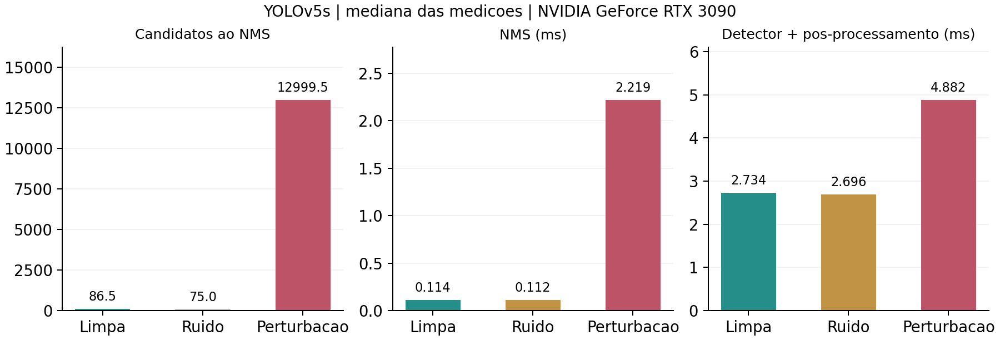
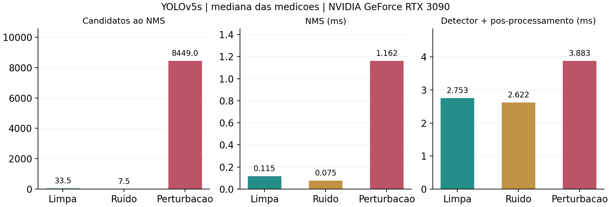

# Primeiros resultados — Groundswell no Yes, CARLA CAN

Data: 28/10/2026. Estado: reprodução adaptada em imagens e painel ao vivo validado pela conexão direta do CARLA. O transporte AVTP ao vivo permanece pendente.

## O que já funciona

O repositório agora contém um consumidor opcional com YOLOv5s, medições separadas de inferência e NMS, exportação de relatórios e imagens anotadas, preparo de dados sem repetir arquivos e um adaptador do ataque Groundswell. Há também captura opcional de frames limpos e aplicação de um delta antes da codificação da câmera. O detector não é executado dentro da callback da câmera.

A verificação inicial teve 72 testes aprovados; a suíte atual, após o painel ao vivo, teve **83 testes aprovados**. Os testes abrangem equivalência do NMS com o artefato, limitação de candidatos, preservação por classe e IoU, validação do delta, canais RGB/BGRA, captura limpa e separação dos conjuntos de dados.

## Configuração executada

- GPU: NVIDIA RTX 3090, 24 GB; Python 3.9.25, PyTorch 2.8.0+cu128 e TorchVision 0.23.0+cu128.
- Modelo e código: artefato 20397573 dos autores, verificado por SHA-256; entrada RGB 640×640, FP32.
- Treino: 160 imagens BDD100K, 100 épocas, lote 8, semente 42, razão RPB 0,4, raio L2 70, passo 0,0008 e peso de área 10.
- Avaliação de referência: 30 outras imagens BDD100K, 10 repetições por condição.
- Transferência: a mesma perturbação aplicada sem novo treino a quatro frames de uma gravação existente do CARLA; 10 repetições por condição.
- Condições: limpa, ruído não otimizado com mesmo suporte e norma L2, perturbação treinada.

A repetição mede variação temporal. Assim, há 30 cenas de referência, não 300; no CARLA há quatro frames de um único vídeo curto, não 40 percursos. Nenhum arquivo com hash de treino foi reutilizado como teste.

## Referência BDD100K

| Condição | Candidatos ao NMS (média) | NMS (mediana ms) | Total do detector (mediana ms) | Detecções originais preservadas |
| --- | ---: | ---: | ---: | ---: |
| Limpa | 87.93 | 0.114 | 2.734 | 100.0% |
| Ruído | 76.77 | 0.112 | 2.696 | 70.0% |
| Perturbação | 13620.80 | 2.219 | 4.882 | 35.2% |

Nesse piloto, o NMS ficou aproximadamente 19,5 vezes mais lento e o total do detector aumentou cerca de 79%. A preservação foi de aproximadamente 35%, mostrando que o efeito sobre a disponibilidade vem acompanhado de perda de detecções. Isso reproduz o mecanismo estudado em uma configuração adaptada; não é uma reprodução exata das tabelas do artigo.

## Transferência para os frames do CARLA

| Condição | Candidatos ao NMS (média) | NMS (mediana ms) | Total do detector (mediana ms) | Detecções originais preservadas |
| --- | ---: | ---: | ---: | ---: |
| Limpa | 32.25 | 0.115 | 2.753 | 100.0% |
| Ruído | 9.50 | 0.075 | 2.622 | 35.0% |
| Perturbação | 8503.25 | 1.162 | 3.883 | 15.0% |

Nos quatro frames, o NMS ficou aproximadamente 10 vezes mais lento e o total aumentou cerca de 41%. Entretanto, apenas 15% das detecções originais foram preservadas. O efeito de aumento de candidatos transferiu; a preservação de objetos ainda é insuficiente para uma demonstração convincente de furtividade nesse cenário.

## Alcance dos resultados

Os tempos incluem inferência e pós-processamento instrumentados, com sincronização CUDA. Leitura, redimensionamento, transferência para a GPU, aplicação da perturbação, desenhos e gravações ficam fora do total do detector. Portanto, não são latência ponta a ponta do veículo ou da rede.

Nenhuma medição de avaliação excedeu o orçamento experimental de 33,333 ms. Não foi demonstrada perda de prazo em tempo real, falha de frenagem, colisão ou efeito no controle do veículo. Preservação compara as previsões limpas, sem medir acurácia contra anotações reais.

A amostra é reduzida, o vídeo do CARLA é curto e contém avisos de recuperação de decodificação, e a GPU também atende ao desktop. A pilha moderna de bibliotecas e o ciclo de treino adaptado diferem da configuração original. Não foram avaliados YOLOv8/11, economia de CPU, comparações de tempo de treinamento nem o transporte AVTP ao vivo.

## Onde estão os dados desta execução

- `.perception/runs/baseline/`: referência inicial sem ataque nos frames do CARLA.
- `.perception/datasets/bdd-pilot/manifest.json`: composição dos conjuntos de treino e teste.
- `.perception/runs/bdd-r04/`: perturbação float32, perdas e configuração do treino.
- `.perception/runs/bdd-r04-evaluation/`: CSV por frame, resumo, manifesto e exemplos da avaliação BDD100K.
- `.perception/runs/bdd-to-carla-r04/`: comparação de transferência para o CARLA.
- `.perception/runs/legacy-v1/`: pilotos anteriores, preservados com sua configuração original e separados da reprodução atual.

Pesos e dados externos ficam ignorados pelo Git em `.perception/`. Os gráficos acima e este relato ficam na documentação do projeto.

## Próximo marco

Capturar percursos independentes no CARLA, ajustar e avaliar a perturbação nessa geometria de câmera e comparar as razões RPB 0,0, 0,4 e 0,8. Depois, verificar a preservação do efeito após a codificação e transmissão AVTP. O [painel ao vivo](perception-live.md) já foi validado com o simulador ativo pela conexão direta do CARLA. A recepção no namespace AVTP e a aplicação anterior à compressão continuam como validações separadas.

Os comandos e as diferenças em relação ao artefato original estão no [guia de execução](perception-latency.md).
